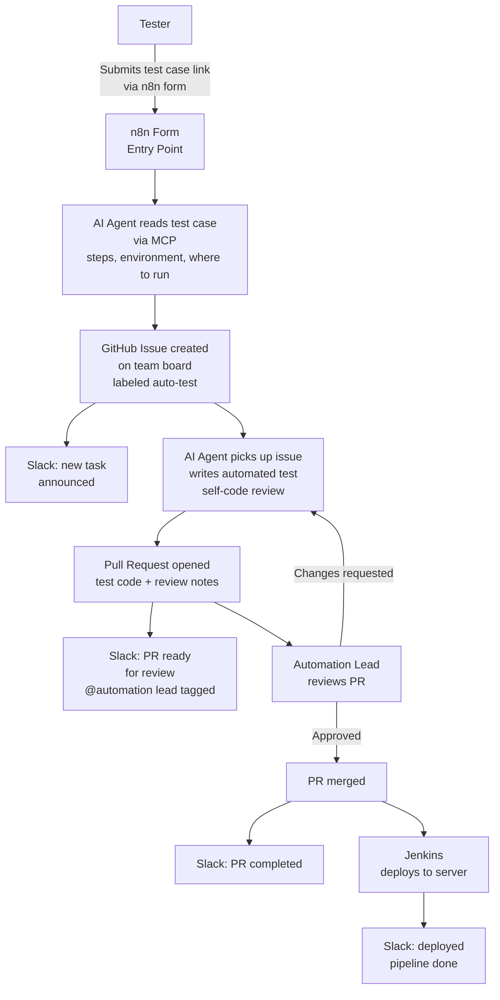
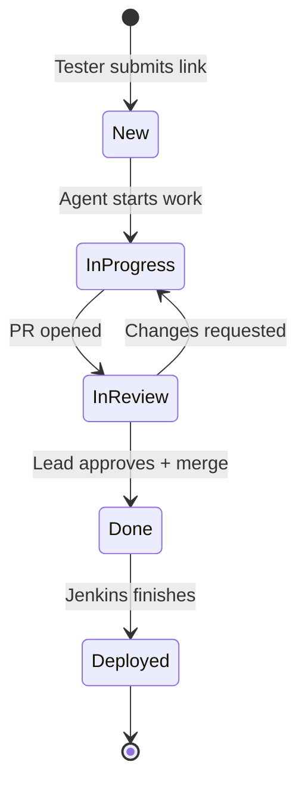

# Business Flow: Automated Test Case Pipeline

End-to-end process from tester to production deploy. Business view, no infrastructure details.

---

## Main Flow

---

## Roles

| Role | What they do |
|------|-------------|
| **Tester** | Fills the form, pastes test case link. Done. |
| **AI Agent** | Reads the test case via MCP, creates the issue, writes the test, self-reviews, opens the PR. |
| **Automation Lead** | Reviews the PR. Approves or sends back. |
| **Jenkins** | Deploys after merge. Only role outside the dev loop. |

---

## Status Transitions on the Board

---

## Slack Notification Moments

1. **New task** — issue created, who submitted, link to test case.
2. **PR ready** — PR link, automation lead mentioned.
3. **PR completed** — merged, who approved.
4. **Deployed** — Jenkins result, success or failure.

All messages use Slack blocks: title, context, button to the relevant GitHub page.
