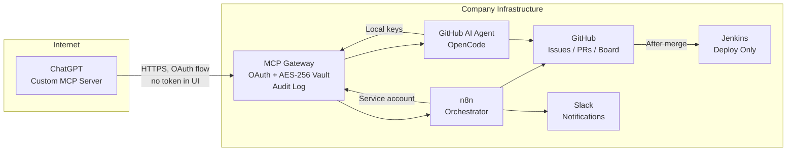
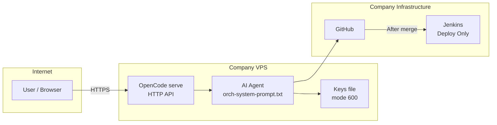

# Architecture: MCP Gateway + OpenCode Self-Hosted

Two integration options for leadership review. No VPN, no tokens in chat UI, all secrets stay in-house.

---

## Option 1: MCP Gateway with OAuth (recommended)

**How it works:**
- ChatGPT connects to the gateway via OAuth in the browser — zero tokens typed in the chat UI.
- Gateway holds all secrets in an AES-256 vault, injects them only at call time.
- Every tool call is audited on your side.
- n8n and the GitHub agent also route through the same gateway.
- Jenkins stays out of the loop except post-merge deploy.

---

## Option 2: OpenCode Self-Hosted

**How it works:**
- OpenCode runs on your VPS, exposed as an HTTP server.
- API keys live in a local file with mode 600 — never leave the box.
- Full control: what the agent can do, which keys, which budget.
- Needs public HTTPS or a tunnel for external access.

---

## Recommendation

**Option 1** for the n8n + GitHub board + Slack pipeline: one gateway, one audit trail, OAuth for ChatGPT.
**Option 2** if you want maximum isolation and already run OpenCode.
